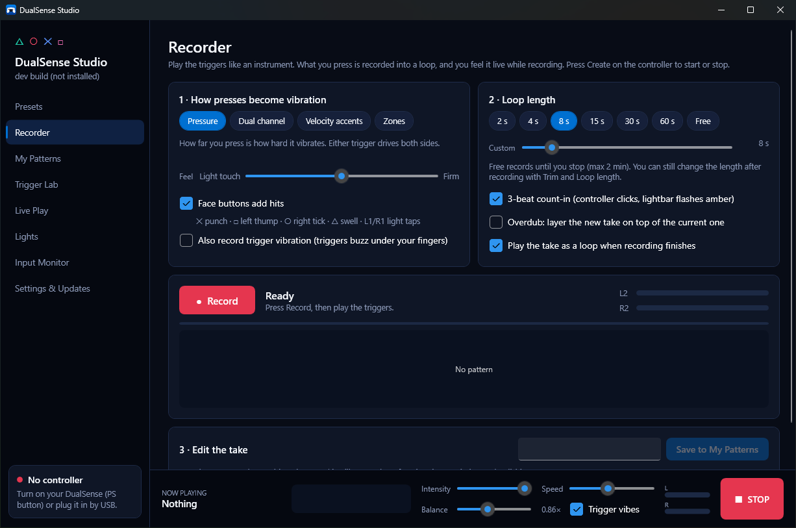
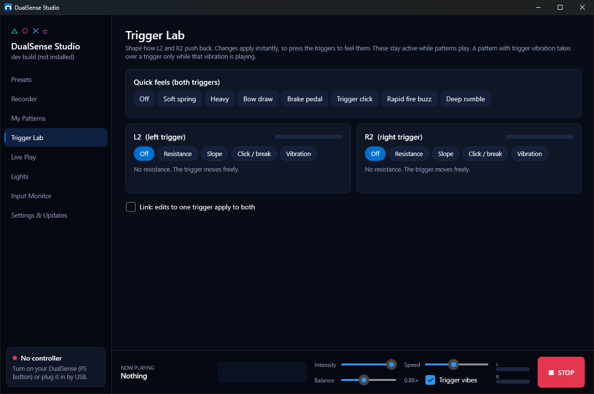

# DualSense Studio

[](https://github.com/JackLongman12/ps5-vibrator/actions/workflows/ci.yml)

A Windows app for controlling the PS5 DualSense controller's vibration, adaptive triggers and lights. Play looping vibration presets, record your own patterns by playing the triggers like an instrument, edit them on a timeline, and drive the controller live from the touchpad, motion sensors or your PC's audio.


## Install

1. Download **`DualSenseStudio-win-Setup.exe`** from the [latest release](https://github.com/JackLongman12/ps5-vibrator/releases/latest).
2. Run it. The build isn't code-signed yet, so Windows SmartScreen may ask you to confirm with **More info → Run anyway**.
3. Connect your DualSense by USB or Bluetooth (pair it in Windows Bluetooth settings: hold **Create + PS** until the light flashes).

The app updates itself. It checks GitHub on start and every 20 minutes, downloads new versions in the background, and shows a **Restart & update** banner.

## Features

| | |
|---|---|
| **Presets** | 18 looping patterns (Heartbeat, Wave, Engine Rev, Thunder, SOS…), with live intensity, speed and left/right balance. |
| **Recorder** | Record a loop from L2/R2. Four mappings decide how presses turn into vibration (Pressure, Dual channel, Velocity accents, Zones). Face buttons add hits. You can use a count-in, overdub, and a fixed (2–60 s) or free take length. You feel the take live while recording. |
| **Editor** | Draw on the waveform. Trim, change the loop length (time-stretch), quantize to a BPM, smooth, adjust gain or normalize, crossfade the loop seam, reverse and swap sides. Undo is available. |
| **Trigger Lab** | Adaptive trigger resistance, slope, click/break and trigger vibration, plus one-click presets. Settings are remembered. |
| **Live Play** | Use the touchpad as an XY pad, tilt and shake (motion), or audio-reactive mode (bass drives the left side, treble the right). |
| **Lights** | The lightbar can follow the vibration, show a static colour, cycle a rainbow or show battery level. The player LEDs can act as an intensity meter. |
| **Safety** | A maximum-intensity cap and an auto-stop timer. Stop everything with **Esc**, **Ctrl+Alt+S** from any app, or the controller's **Mute** button. |
| **Controller shortcuts** | Options plays/stops, D-pad ◀ ▶ changes preset, ▲ ▼ changes intensity, Create records. |

<p>
  
  
</p>

## Uninstall

Use either of these:

- In the app, go to **Settings & Updates → Uninstall** and click **Uninstall DualSense Studio…**. Tick *Also delete my saved patterns and settings* for a clean removal.
- In Windows, go to **Settings → Apps → Installed apps → DualSense Studio → Uninstall**.

Both remove the app, its shortcuts and its Windows entry. Uninstalling from Windows Settings keeps your patterns in `%AppData%\DualSenseStudio`. Delete that folder by hand if you don't want them.

## Troubleshooting

- **No vibration or triggers while Steam is open:** Steam Input can take over the controller. Turn off *PlayStation Controller Support* in Steam → Settings → Controller, or close Steam. DS4Windows and DSX can conflict in the same way. The app warns you when any of them are running.
- **Vibration is weak or missing:** try the other *Rumble mode* in Settings (Modern v2 / Legacy v1).
- **Your pattern files** are in `%AppData%\DualSenseStudio\patterns`, saved as `*.dspattern.json`. They can be shared and imported.

## Build from source

You need the [.NET 10 SDK](https://dotnet.microsoft.com/download) on Windows.

```bash
git clone https://github.com/JackLongman12/ps5-vibrator.git
```

```bash
cd ps5-vibrator
```

```bash
dotnet build DualSenseStudio.sln
```

```bash
dotnet test DualSenseStudio.sln
```

```bash
dotnet run --project src/DualSenseStudio.App
```

| Path | |
|---|---|
| `src/DualSenseStudio.Core` | Platform-neutral code: DualSense HID protocol (USB + Bluetooth with CRC32), the 100 Hz haptics engine, patterns, the recorder, and live sources |
| `src/DualSenseStudio.App` | WPF (.NET 10) UI, settings, audio capture, and the Velopack updater |
| `tests/DualSenseStudio.Core.Tests` | Protocol, encoding, pattern-tool, storage-hardening and recorder tests |
| `scripts/release.ps1` | Test → build → package → publish a GitHub release (maintainers) |

To release (maintainers only, needs `gh auth login`):

```powershell
.\scripts\release.ps1 -Notes "What changed"
```

## Security

See [SECURITY.md](SECURITY.md) for how updates, tokens and imported files are handled, and how to report a problem.

## Credits

The DualSense report layouts follow the Linux `hid-playstation` driver. The adaptive-trigger effect encodings follow community documentation of the DualSense trigger format. This project isn't affiliated with or endorsed by Sony Interactive Entertainment. "PlayStation" and "DualSense" are trademarks of their respective owners.

## License

[MIT](LICENSE)
